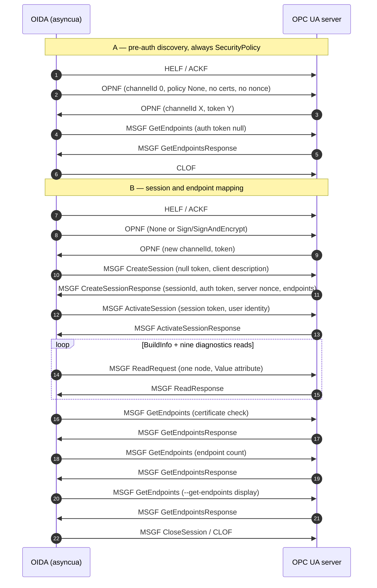

# OPC UA — OIDA `--get-endpoints` fingerprint

Detection content for OIDA's OPC UA endpoint-mapping run:

```bash
oida opcua opc.tcp://<target>:4840 --get-endpoints
```

Reference: OIDA 1.0.6 (`oida-ics`), asyncua client, OPC UA Binary over TCP/4840.
The companion capture [`get-endpoints.pcapng`](get-endpoints.pcapng) is **one
instance** of the behaviour described here; the flow, not the frame numbers,
is what the rules match.

This page explains the global behaviour first, then the secure-channel and
session lifecycle, the endpoint map, the FreeOpcUa stack strings, and finally
the Suricata rules in
[`oida_opcua_get_endpoints.rules`](oida_opcua_get_endpoints.rules).

---

## 1. The behaviour in one page

`oida opcua <url>` never uses a single TCP connection. The endpoint-mapping run
is always **two connections**:

| Phase | Connection | Security | Services | Purpose |
| --- | --- | --- | --- | --- |
| A — pre-auth discovery | new TCP socket | **always `SecurityPolicy#None`** | `HEL`, `ACK`, `OPN`, `GetEndpoints` (null auth token), `CLO` | find out whether the server advertises an anonymous endpoint and which policies/modes it offers |
| B — session and mapping | second TCP socket | `None` by default, or the requested `--policy`/`--mode` | `HEL`, `ACK`, `OPN`, `CreateSession`, `ActivateSession`, 10 × `Read`, 2-3 × `GetEndpoints`, `CloseSession`, `CLO` | create an anonymous session, map BuildInfo + security posture, inspect the certificate, print the endpoints |

Connection A is **not a session**: `GetEndpoints` is a discovery service and is
called with `AuthenticationToken = null`. Connection B creates a session and
carries that session's token in every subsequent request.



### Invariants that matter for detection

- **Two connections, two channels.** The pre-auth channel and the session
  channel get different `secureChannelId` values, but may reuse the same
  `tokenId` (the server assigns both).
- **Connection A is always `None`.** OIDA 1.0.6 creates the pre-auth client
  before it applies `--policy`/`--mode`; the first `OPN` therefore carries
  `SecurityPolicy#None`, null certificates and an empty nonce even when the
  session afterwards is `Sign` or `SignAndEncrypt`.
- **Connection A has no session.** The `GetEndpoints` request has a null
  `AuthenticationToken`; there is no `CreateSession` on that socket.
- **Connection B may stop early.** If the server does not advertise an
  anonymous endpoint and no credentials were supplied, OIDA returns after
  connection A. Only the pre-auth indicator is visible.
- **Ten fixed reads.** One `BuildInfo` read followed by nine diagnostics /
  security reads, each a separate single-node `Value` read (section 5).
- **Two or three `GetEndpoints` on B.** `_check_certificate()` and the result
  count always call `get_endpoints()`; the `--get-endpoints` flag adds a third
  call for display. The three calls are back-to-back, identical, and are not a
  retry loop. Without the flag there are two.
- **Immediate teardown.** `CloseSession` then `CloseSecureChannel`; the whole
  run is typically well under one second.

The pre-auth `GetEndpoints` is the operation that remains visible even when
the session is encrypted, because connection A is always `None`.

---

## 2. Why the first connection is not secure

In `cli_runner.py` the order is:

1. `self._client = Client(url=url, timeout=timeout)`
2. `await self._pre_auth_discovery(url)`
3. only afterwards: `_configure_secure_channel(...)` on a **new** client for
   the session.

`_pre_auth_discovery()` calls asyncua
`Client.connect_and_get_server_endpoints()`. That helper uses
`_with_temp_channel(get_endpoints)`: open socket, `HEL`, `OPN`, run
`GetEndpoints`, `CLO`, close socket. It never creates a session.

So the "not secure" connection is not an accident or a fallback: it is the
first phase of the tool. Consequences:

- The pre-auth `OPN` is always `#None` with null `SenderCertificate`,
  `ReceiverCertificateThumbprint`, `ClientNonce` and `ServerNonce`.
- The pre-auth `GetEndpointsRequest`/`Response` bodies are plaintext and
  readable on the wire.
- A server that demands `SignAndEncrypt` on every channel will reject
  connection A, and OIDA's default anonymous run stops there.
- If the operator supplies `--policy`/`--mode`, only connection B is secured;
  connection A remains a plaintext discovery probe.

This asymmetry is a useful detection property: the **pre-auth discovery is
always observable**, while the session phase may not be.

---

## 3. Secure-channel and session lifecycle

### 3.1 HEL / ACK

`HEL` negotiates protocol version, receive/send buffer sizes, maximum message
size, maximum chunk count and the requested `EndpointUrl`. `ACK` returns the
server's limits. This is identical for every OPC UA client and is not an OIDA
indicator.

### 3.2 OPN — opening the secure channel

`OpenSecureChannelRequest` is sent with `secureChannelId = 0`. The message
header carries:

| Field | Meaning |
| --- | --- |
| `securityPolicyUri` | `#None`, `#Basic256Sha256`, `#Aes128_Sha256_RsaOaep`, … |
| `senderCertificate` | client X.509 certificate (null for None) |
| `receiverCertificateThumbprint` | SHA-1 of the server certificate (null for None) |
| `sequenceNumber`, `requestId` | message sequence |
| `TypeId` | `OpenSecureChannelRequest` (446) |

The request body contains `clientProtocolVersion`, `securityTokenRequestType`
(`Issue` or `Renew`), `messageSecurityMode` (`None`, `Sign`,
`SignAndEncrypt`), `clientNonce` and `requestedLifetime` (OIDA asks for
3 600 000 ms).

The response returns the assigned `secureChannelId`, the same policy, the
server certificate and nonce (for secure policies), and a
`ChannelSecurityToken`:

| Token field | Meaning |
| --- | --- |
| `channelId` | same as `secureChannelId` |
| `tokenId` | identifies the key material for subsequent `MSG` chunks |
| `createdAt` | token creation time |
| `revisedLifetime` | server-granted lifetime |

All later `MSG` and `CLO` chunks carry both `secureChannelId` and `tokenId`.
The token is renewed with a new `OPN` of type `Renew` before the lifetime
expires.

### 3.3 What the security mode actually protects

| Mode | OPN body | MSG body | What payload rules can see |
| --- | --- | --- | --- |
| `None` | plaintext | plaintext | everything |
| `Sign` | signed, not encrypted | signed, not encrypted | service bodies are still plaintext; content patterns still match |
| `SignAndEncrypt` | signed and asymmetrically encrypted | signed and symmetrically encrypted | only `MSG` headers, `OPN` policy/certificate fields and `CLO` headers |

This distinction matters: `Sign` does **not** hide the service payload, so the
atomic rules still work. `SignAndEncrypt` hides it, so only the pre-auth
discovery remains visible.

### 3.4 Session creation

`CreateSessionRequest` (461) is sent with a null `AuthenticationToken` and a
`ClientDescription`. The server returns:

- `SessionId` (a NodeId);
- `AuthenticationToken` (a NodeId, used by every subsequent request);
- `RevisedSessionTimeout`;
- `ServerNonce`;
- `ServerCertificate`;
- `ServerEndpoints` (the same array as `GetEndpointsResponse`);
- `ServerSoftwareCertificates`, `ServerSignature`, `MaxRequestMessageSize`.

`ActivateSessionRequest` (467) then carries the authentication token, a client
signature (empty for anonymous), locale ids, and a `UserIdentityToken`.
OIDA's default is `AnonymousIdentityToken` with `PolicyId = "anonymous"` and
`LocaleIds = ["en"]`. Credentials or certificates change the identity token
but not the sequence.

`CloseSession` (473) and `CloseSecureChannel` (452) tear the session and the
channel down.

---

## 4. The two or three GetEndpoints

`GetEndpoints` is a discovery service; it can be called with or without a
session. OIDA calls it in three different places on connection B:

| Call | Code path | Purpose |
| --- | --- | --- |
| 1 | `_check_certificate()` | take the first `EndpointDescription.ServerCertificate` and run certificate checks |
| 2 | result assembly | count endpoints for the JSON/console result |
| 3 | `_get_endpoints()` when `--get-endpoints` is set | print URL / policy / mode / level |

Calls 1 and 2 are unconditional; call 3 exists only with the flag. All three
use the same `EndpointUrl` and return the same array. The requests are
back-to-back (milliseconds apart), not a retry or a fallback.

This is a strong behavioural marker: a normal HMI or engineering client calls
`GetEndpoints` once, or not at all after the session is created. OIDA calls it
twice by default and three times for this command.

---

## 5. The ten reads

`_get_server_info()` performs one read; `_check_server_security()` performs
nine. Each is a separate `ReadRequest` with exactly one node and
`AttributeId = Value`:

| # | NodeId | Browse name | What OIDA extracts |
| --- | --- | --- | --- |
| 1 | 2260 | `Server_ServerStatus_BuildInfo` | ProductUri, ManufacturerName, ProductName, SoftwareVersion, BuildNumber, BuildDate |
| 2 | 2994 | `Server_Auditing` | audit logging enabled? |
| 3 | 2269 | `Server_ServerCapabilities_ServerProfileArray` | advertised profiles; RBAC inference |
| 4 | 2294 | `Server_ServerDiagnostics_EnabledFlag` | diagnostics enabled (information leak) |
| 5 | 2279 | `..._SecurityRejectedSessionCount` | rejected sessions |
| 6 | 2287 | `..._SecurityRejectedRequestsCount` | rejected requests |
| 7 | 2277 | `..._CurrentSessionCount` | active sessions |
| 8 | 3707 | `..._SessionDiagnosticsArray` | client apps, connection times, subscription counters |
| 9 | 3708 | `..._SessionSecurityDiagnosticsArray` | user ids, authentication mechanism, security mode per session |
| 10 | 3709 | `Server_ServerRedundancy_RedundancySupport` | redundancy mode |

The nine security reads are not unique to OIDA. OIDA's source comments cite
OpalOPC check IDs (`10002` auditing, `10004` RBAC), and any scanner that
implements the same posture checks will issue a similar set. What makes the
sequence an OIDA fingerprint is the combination with the pre-auth discovery,
the FreeOpcUa/asyncua client identity, and the repeated `GetEndpoints`.

---

## 6. Endpoint mapping

### 6.1 What GetEndpointsResponse contains

Each `EndpointDescription` carries:

| Field | Meaning |
| --- | --- |
| `EndpointUrl` | `opc.tcp://host:port/path` |
| `Server` | `ApplicationDescription`: ApplicationUri, ProductUri, ApplicationName, ApplicationType, GatewayServerUri, DiscoveryProfileUri, DiscoveryUrls |
| `ServerCertificate` | DER X.509 certificate |
| `SecurityMode` | None / Sign / SignAndEncrypt |
| `SecurityPolicyUri` | `#None`, `#Basic256Sha256`, `#Aes128_Sha256_RsaOaep`, … |
| `UserIdentityTokens[]` | PolicyId + TokenType (Anonymous / UserName / Certificate / IssuedToken) |
| `TransportProfileUri` | e.g. `uatcp-uasc-uabinary` |
| `SecurityLevel` | server-assigned rank |

### 6.2 How OIDA turns it into a map

| OIDA method | Input | Output |
| --- | --- | --- |
| `_show_endpoints_summary()` | pre-auth endpoint list | count, modes → policies, auth types, `has_anonymous`, `has_mode_none`, `has_policy_none`, `has_sign_only`, deprecated-policy warnings, certificate findings |
| `_get_endpoints()` | post-auth endpoint list | `url`, `policy` (after `#`), `mode`, `level` per endpoint |
| `_check_certificate()` | first non-empty `ServerCertificate` | key size, signature algorithm, validity, SAN/URI, self-signed/weak-cert findings |
| `_get_server_info()` | BuildInfo 2260 | product, vendor, version, build number, build date, product URI |
| `_check_server_security()` | the nine reads | auditing, RBAC profile, diagnostics leak, rejection counters, active sessions, per-session client/auth data, redundancy |

The endpoint map is therefore **not** just the `GetEndpoints` array. OIDA
combines the advertised endpoints (policy/mode/level, user tokens,
certificate) with the server's BuildInfo and its diagnostics/security posture.
That combined behaviour is exactly what the correlation rule fingerprints.

### 6.3 Example from the reference capture

The capture's mock server advertises four endpoints, all on
`opc.tcp://127.0.0.1:4840/freeopcua/server/`, all with the same certificate
(`CN=OIDA Mock OPC UA Server`) and the same three user-token policies
(anonymous, certificate, username):

| # | SecurityPolicy | Mode | Level |
| --- | --- | --- | --- |
| 0 | None | None | 0 |
| 1 | Basic256Sha256 | SignAndEncrypt | 70 |
| 2 | Basic256Sha256 | Sign | 50 |
| 3 | Aes128_Sha256_RsaOaep | SignAndEncrypt | 75 |

Those numbers are server-specific. The rules match the **behaviour** (the
reads, the three GetEndpoints, the pre-auth discovery), not the endpoint count,
policy, mode, level or certificate.

---

## 7. FreeOpcUa, asyncua, OpalOPC and OIDA

Three different identifiers appear in this flow. They identify different
things.

| String | Default source | Seen in | Meaning |
| --- | --- | --- | --- |
| `urn:example.org:FreeOpcUa:opcua-asyncio` | asyncua `Client.__init__` (`application_uri`) | `CreateSession` client description | asyncua client (OIDA's client) |
| `urn:freeopcua.github.io:client` | asyncua **and** python-opcua `Client.__init__` (`product_uri`) | `CreateSession` client description | Python FreeOpcUa family client, not a specific tool |
| `urn:freeopcua.github.io:python:server` | python-opcua `Server.__init__` (`product_uri`) | `GetEndpointsResponse`, `CreateSessionResponse`, BuildInfo 2260 | FreeOpcUa/python-opcua server (the mock target) |

### 7.1 Client side (OIDA)

OIDA builds `asyncua.Client(url)` without overriding the client description.
asyncua's compiled-in defaults are:

```text
name            Pure Python Async Client
application_uri urn:example.org:FreeOpcUa:opcua-asyncio
product_uri     urn:freeopcua.github.io:client
```

The `ProductUri` is inherited from FreeOpcUa's python-opcua and is also the
default of the synchronous client. It therefore says "Python FreeOpcUa
family", **not** "OIDA". The `ApplicationUri` is the asyncua-specific part; the
`ApplicationName` confirms the stack.

This is why rule `9999931` matches all three strings, and why it is only a
stack indicator. The OIDA conclusion comes from the correlation.

### 7.2 Server side (mock target)

The mock uses python-opcua (FreeOpcUa) as its server library. Its defaults
are:

```text
application_uri urn:freeopcua:python:server
product_uri     urn:freeopcua.github.io:python:server
name            FreeOpcUa Python Server
manufacturer    FreeOpcUa
BuildInfo       ProductUri=urn:freeopcua.github.io:python:server,
                ManufacturerName=FreeOpcUa, ProductName=FreeOpcUa Python Server,
                SoftwareVersion=1.0pre, BuildNumber=0
```

The mock overrides the endpoint `ApplicationUri` to
`urn:oida:mock:opcua:server` and the `ApplicationName` to
`OIDA Enhanced Mock OPC UA Server`, but leaves the `ProductUri` and the
BuildInfo at the FreeOpcUa defaults.

That is why the capture shows `urn:freeopcua.github.io:python:server` while
the client shows the asyncua ApplicationUri. They are two sides of the same
Python FreeOpcUa lineage, not the same product.

**Do not require the server ProductUri in the OIDA correlation.** Real OIDA
targets can run any OPC UA stack (Prosys, Kepware, Siemens, .NET, C++, …).
`urn:freeopcua.github.io:python:server` only identifies a FreeOpcUa-based
server such as the mock. It belongs to a target-fingerprint rule, not to the
OIDA fingerprint.

### 7.3 OpalOPC

OpalOPC is a C#/.NET OPC UA vulnerability scanner
(`github.com/ValtteriL/OpalOPC`), not a FreeOpcUa/Python client. It therefore
does not emit `urn:freeopcua.github.io:client`.

The connection to OIDA is the **check set**, not the stack: OIDA's
`_check_server_security()` comments reference OpalOPC plugin IDs (`10002`
auditing, `10004` RBAC), and the nine-read posture audit overlaps with what an
OpalOPC-style scan does. So:

- the FreeOpcUa/asyncua strings identify the **Python stack** (OIDA's client or
  the FreeOpcUa mock target);
- the nine reads identify a **security posture audit** shared with
  OpalOPC-style scanners;
- only the full correlated sequence (pre-auth None discovery + FreeOpcUa client
  identity + ten reads + repeated GetEndpoints) is an OIDA fingerprint.

---

## 8. Detection rules

Rules: [`oida_opcua_get_endpoints.rules`](oida_opcua_get_endpoints.rules).
These rules are also included in the repository-root
[`oida_detection.rules`](../../oida_detection.rules), generated by `make rules`.
SIDs `9999930`-`9999950` (S7comm uses `9999901`-`9999920`).

| SID | Prio | Behaviour | Match |
| --- | --- | --- | --- |
| 9999930 | 3 | pre-auth GetEndpoints, no session | `MSGF` + GetEndpoints (428) + null auth token |
| 9999931 | 3 | CreateSession with FreeOpcUa/asyncua client identity | `MSGF` + CreateSession (461) + the three client strings |
| 9999932 | 3 | Read BuildInfo (2260) | single-node Value read |
| 9999933 | 3 | Read Auditing (2994) | idem |
| 9999934 | 3 | Read ServerProfileArray (2269) | idem |
| 9999935 | 3 | Read Diagnostics EnabledFlag (2294) | idem |
| 9999936 | 3 | Read SecurityRejectedSessionCount (2279) | idem |
| 9999937 | 3 | Read SecurityRejectedRequestsCount (2287) | idem |
| 9999938 | 3 | Read CurrentSessionCount (2277) | idem |
| 9999939 | 3 | Read SessionDiagnosticsArray (3707) | idem |
| 9999940 | 3 | Read SessionSecurityDiagnosticsArray (3708) | idem |
| 9999941 | 3 | Read RedundancySupport (3709) | idem |
| 9999942 | 2 | 3 × GetEndpoints on the session | GetEndpoints with a four-byte auth token, 3/3 s, packet-level |
| 9999950 | 1 | full OIDA fingerprint | GetEndpointsResponse + all 13 flags + 3 responses/3 s |

All atomic rules set `xbits` with `track ip_pair, expire 30` so the flags
survive the two short-lived TCP connections. The correlation rule matches the
server's `GetEndpointsResponse`, requires the 13 flags, and counts three
responses in three seconds.

### Suricata details

- **`flow:no_stream` on the request rules.** Suricata coalesces the three
  GetEndpoints requests into one reassembled stream chunk and reports at most
  one match per rule per chunk. At packet level each request is evaluated
  separately, so `count 3` works. The request PDUs are small and normally fit
  one TCP segment.
- **Threshold and xbits.** Suricata sets `xbits` on every match before it
  applies threshold suppression. The `9999942` flag is therefore set by the
  first request; the correlation rule cannot use it as the 3-request gate. Its
  own response counter is the gate: the first two responses match but stay
  below the count, the third raises the alert.
- **SID `9999931` is a stack indicator.** It matches the client's
  FreeOpcUa/asyncua defaults. Other tools using asyncua can trip it.
- **SID `9999950` is the OIDA claim.** It requires the pre-auth discovery, the
  FreeOpcUa client identity, the ten reads and the repeated GetEndpoints on
  the same IP pair.
- **The server ProductUri is deliberately not required.** See section 7.2.

---

## 9. Validation

```bash
suricata -r OPC-UA/get-endpoint/get-endpoints.pcapng \
  -S OPC-UA/get-endpoint/oida_opcua_get_endpoints.rules \
  -l /tmp/oida-opcua --runmode single -k none

cat /tmp/oida-opcua/fast.log
```

Expected on the reference capture: all 14 rules alert, including the
correlation `9999950` on the third `GetEndpointsResponse`. The atomic alerts
show the per-behaviour detections; `9999942` fires on the third GetEndpoints
request; `9999950` fires once the third response arrives.

Negative checks used to prove the correlation is not a single-rule alias:

| Capture | Rules that alert | Correlation |
| --- | --- | --- |
| pre-auth connection only | `9999930` | no |
| session connection only | `9999931`-`9999942` | no |
| full flow minus the BuildInfo read | 12 rules | no |
| full flow | all 14 rules | yes, `9999950` |

---

## 10. Limitations and tuning

- **`SignAndEncrypt` hides the session behaviour.** The service bodies of
  `CreateSession`, the ten `Read` requests and the three `GetEndpoints` are
  encrypted. Only the pre-auth `GetEndpoints` (connection A is always `None`)
  and the `OPN`/`CLO` headers remain visible. The full correlation cannot fire;
  `9999930` can.
- **`Sign` does not hide the service body.** Messages are signed, not
  encrypted. The content patterns still match, although the chunk includes a
  signature and the offsets are not fixed. The rules do not rely on fixed
  offsets.
- **`--get-endpoints` is required for the 3/3 threshold.** The same OIDA run
  without the flag performs two `GetEndpoints` calls (certificate check +
  result count), not three. The atomic rules still fire; the correlation
  (`9999950`) and `9999942` expect three. Lower the threshold to 2 if you want
  to cover the default scan.
- **Port.** `4840` is hard-coded. OPC UA has no IANA port (4841, 4885, 49320,
  62541, … are common). Change the port or use `alert tcp any any -> any any`
  with the same content; the service patterns are specific enough.
- **Anonymous endpoint required for phase B.** Without anonymous and without
  credentials, OIDA stops after the pre-auth connection; only `9999930` fires.
- **The FreeOpcUa/asyncua strings are not OIDA proof.** They identify the
  Python stack. The same strings appear in any asyncua-based client and in the
  FreeOpcUa mock server.
- **OpalOPC-style audits can trip the ten reads.** The posture audit is not
  unique to OIDA. Tune the correlation by removing a few `xbits:isset` lines if
  your baseline legitimately reads the same nodes.
- **Session token width.** Rule `9999942` distinguishes the session
  `GetEndpoints` by the four-byte authentication token (`01 00 …`) used by the
  FreeOpcUa mock. A server that assigns a two-byte session id would not match
  that atomic rule; the correlation's response counter is unaffected.
- **Segmentation.** The atomic request rules use `flow:no_stream` so the
  3-request counter works. If request PDUs are split across segments, remove
  `no_stream` from the read/GetEndpoints rules (they will match on
  reassembly); keep the correlation's response counter.

---

## 11. References

- Claroty Team82, *OPC UA Deep Dive (Part 3): Exploring the OPC UA Protocol* —
  <https://fr.claroty.com/team82/research/opc-ua-deep-dive-part-3-exploring-the-opc-ua-protocol>
- OPC UA Part 2 — Security Model; Part 4 — Services (`GetEndpoints`, `Read`,
  `CreateSession`, `ActivateSession`); Part 6 — Mappings (OPC UA Binary).
- OIDA 1.0.6 source:
  - `src/oida/protocols/opcua/cli_runner.py` — `_pre_auth_discovery`,
    `_async_proto_flow`, `_show_endpoints_summary`
  - `src/oida/protocols/opcua/mixins/discovery.py` — `_get_server_info`,
    `_get_endpoints`, `_dump_namespaces`
  - `src/oida/protocols/opcua/mixins/security.py` — `_check_server_security`,
    `_check_certificate`
- asyncua defaults: `asyncua/client/client.py` — `Pure Python Async Client`,
  `urn:example.org:FreeOpcUa:opcua-asyncio`, `urn:freeopcua.github.io:client`.
- python-opcua defaults: `opcua/client/client.py` and `opcua/server/server.py`
  — `urn:freeopcua.github.io:client`,
  `urn:freeopcua.github.io:python:server`, `FreeOpcUa Python Server`.
- OpalOPC: <https://github.com/ValtteriL/OpalOPC> (C#/.NET scanner; OIDA
  references its check IDs, not its stack).
- OIDA mock server: `docker/mocks/services/opcua/mock/opcua_server.py`.
