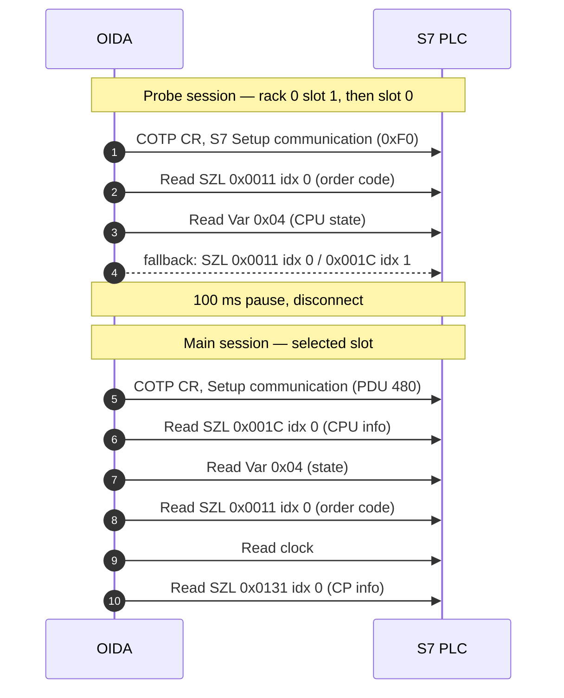

# S7comm — OIDA `-i` fingerprint

Detection content for the first OIDA S7comm fingerprint:

```bash
oida s7 <IP> -i
```

Reference: OIDA 1.0.6, classic S7comm engine (Snap7), TCP/102.
Test capture: `request_id_oida_snap7_1.pcapng` (77 packets,
`oida s7 127.0.0.1 -i -p 10102` against a local mock).

## What `-i` does

`-i` is an **action**, not a scan mode. In `cli_runner.py`, `_has_action()`
returns true and `discover()` is skipped. As a result `-i` does **not** read the
protection level, does not test PUT/GET, does not enumerate DBs and does not run
the security analysis.

The command still performs two distinct phases:

### 1. Connection and automatic slot detection

Because `-s/--slot` is not supplied, `Snap7Scanner.connect()` calls
`scan_slots()` before the info request. Each probe opens a separate ISO-TSAP
session (`TCP/102`), sends `Setup communication`, reads identification data,
then disconnects.

| Phase | Rack/slot probes | Detail |
| --- | --- | --- |
| 1 | `(0,1)`, `(0,0)` | full probe: order code, CPU state, SZL fallbacks |
| 2 | `(0,2)`–`(0,7)`, `(1,2)`, `(1,3)` | only if no slot answered in phase 1, or with `-F`; order code + firmware only |

Each probe is followed by a 100 ms sleep. The first CPU-class result becomes the
main slot; a communication processor (`S7-CP`) is not preferred over a CPU.
For S7-1200/1500, OIDA 1.0.6 prints `S7CommPlus protocol NOT SUPPORTED` and
falls back to classic Snap7 access.

### 2. `info_action()` on the main session

The selected rack/slot is used for a new session. `info_action()` calls, in this
order:

| # | OIDA call | S7 operation | Purpose |
| --- | --- | --- | --- |
| 1 | `_get_cpu_info()` | SZL `0x001C` index `0` | module type, serial, AS name, module name, copyright |
| 2 | `_get_plc_status()` | Read Var `0x04` | CPU run/stop state |
| 3 | `get_order_code()` | SZL `0x0011` index `0` | MLFB order code and firmware `V1.V2.V3` |
| 4 | `get_pdu_length()` | local negotiated value | PDU size from `Setup communication` |
| 5 | `get_plc_datetime()` | Read clock (`CPU services`, subfunction `1`) | PLC clock |
| 6 | `get_cp_info()` | SZL `0x0131` index `0` | max PDU, connections, MPI/bus rate |

The order code is resolved through a built-in `SIEMENS_DEVICES` table: exact
match after `strip().upper()`, then a 17-character prefix match. No external
fingerprint file is used. Nothing in this path writes to the PLC, so
`--confirm` is not required.

## Observed PDU sequence

Reference capture sessions: probes on `:57952` and `:57954`, main info session
on `:57970`.



The fallbacks are conditional: a PLC that returns a valid `6ES7...` order code
and a module name may omit them. Atomic rules must therefore match the
unconditional requests, not the fallback count.

## Rules

| SID | Match | Fingerprint value | Priority |
| --- | --- | --- | --- |
| `9999901` | SZL `0x0011` index `0` | order code / module identification | 3 |
| `9999902` | SZL `0x001C` index `0` | all component identification records | 3 |
| `9999903` | SZL `0x001C` index `1` | module name (automation system) | 3 |
| `9999905` | SZL `0x0131` index `0` | communication capability parameters | 3 |
| `9999920` | all four `xbits` in 5 s | full OIDA `-i` fingerprint | 1 |

### Match anatomy

The rules anchor on the encapsulated S7 request, not on the TCP connection:

```text
03 00                 TPKT version 3, reserved 0
02 F0 80              COTP header length 2, DT, TPDU 0x80
32 07                 S7 protocol 0x32, ROSCTR Userdata 0x07
...
00 01 12 04 11 44 01 00   userdata header: CPU functions (0x04), Read SZL (0x01)
...
00 11 00 00           SZL-ID 0x0011, index 0x0000
```

The atomic rules use `distance:0; within:12` for the SZL pair so the ID/index
must appear inside the same userdata request. Each rule sets a distinct
`xbits` name with `track ip_pair, expire 5`.

Cross-flow correlation is necessary: a single `-i` run produces two slot-probe
sessions plus the main info session. A flow-scoped flag would never see all
four indicators.

### Correlation

`9999920` matches the PLC **response** (`flow:to_client`) to the final
`0x0131` request. By then all four flags have been set:

```text
xbits:isset,szl_0011,track ip_pair
xbits:isset,szl_001c_all,track ip_pair
xbits:isset,szl_001c_name,track ip_pair
xbits:isset,szl_0131,track ip_pair
```

The previous revision matched the client-to-server direction. On the reference
capture it did not fire: the rule could be evaluated before the `0x0131` setter
in the same packet, and no later client packet existed. Matching the server
response makes the ordering deterministic and fires on packet 61.

## Output reference

OIDA prints the slot sweep, then the info block. Typical fields:

```text
Main CPU: Rack 0 Slot 1
S7 CPU: CPU 315-2 PN/DP (S7-300) - CPU 315-2 PN/DP
PLC Status: Run
S7-300 - CPU 315-2 PN/DP
    Serial: S C-C2UR28922012
    Status: Run
    PDU: 480
    Time: 2026-10-21 12:37:09
    Max Connections: 32
```

`Status: Run` is derived from Snap7's `S7CpuStatusRun` string; anything without
`Run` or `Stop` is passed through unchanged. `Time` comes from the PLC clock,
not from the host.

See [`oida_s7_i.png`](oida_s7_i.png) for the captured terminal output.

## OIDA S7 capability map

The full `oida s7 -h` surface, for context when extending the rule set:

| Group | Commands | Writes / state change |
| --- | --- | --- |
| Connection | `-p`, `-R/--rack`, `-s/--slot`, `--connection-type`, `--pdu-size`, `--timeout` | no |
| Discovery | `-i`, `-e`, `-T`, `-F`, `-S` | no (`-T` probes writes only with `--confirm`) |
| SZL / system | `-L`, `-E`, `--read-szl-id`, `-G` | no |
| Memory read | `-I`, `-Q`, `-M`, `--read-timers`, `--read-counters`, `-r`, `-D` | no |
| Memory write | `-w`, `--write-markers`, `--write-outputs`, `--write-inputs`, `--write-timers`, `--write-counters`, `--db-fill`, `--test-write` | yes, `--confirm` |
| Block operations | `-l`, `-B`, `--list-blocks-of-type`, `-U`, `--upload-block`, `-O` | no |
| Block mutation | `--download-db`, `--delete-block` | yes, `--confirm` |
| CPU control | `--cpu-stop`, `--cpu-start`, `--cpu-hot-start`, `--restart`, `-K/--copy-ram-to-rom`, `--compress` | yes, `--confirm` |
| Clock | `-G`, `--set-datetime`, `--sync-datetime` | set/sync: `--confirm` |
| Monitor | `--monitor`, `--monitor-areas` (`I,Q,M`), `--monitor-size` (16), `--monitor-bits`, `--interval` (0.5 s), `--duration` | no |
| Credentials | `-n/--null-password`, `--default-creds`, `--brute --wordlist`, `-P FILE`, `--brute-rate`, `--continue-on-success`, `--logout` | brute/default: `--confirm` |
| Audit | `--audit`, `--audit-quick` | yes, `--confirm` |
| Fuzzing | `--fuzz db\|memory\|all`, `--fuzz-db`, `--fuzz-iterations`, `--fuzz-max-targets` | yes, `--confirm` |

Note: `--cpu-start` maps to a **hot** start; the cold start is `--restart`.
`--audit` runs seven stages (identity, protection, memory access, write probe,
DB enumeration, SZL disclosure, default passwords); `--audit-quick` drops the
password stage.

## Validation

```bash
suricata -r request_id_oida_snap7_1.pcapng \
  -S s7comm/oida_s7_-i_detection.rules \
  -l /tmp/oida-s7 --runmode single -k none

cat /tmp/oida-s7/fast.log
```

Result on the reference capture:

| SID | Alerts | Notes |
| --- | --- | --- |
| `9999901` | 3 | two probe sessions + main session |
| `9999902` | 1 | main session, index 0 |
| `9999903` | 2 | probe sessions, index 1 |
| `9999905` | 1 | main session, CP info |
| `9999920` | 1 | server response to the `0x0131` request |

## Limitations and false positives

- **Scope:** only the `-i` fingerprint. `-E`, `-L`, `--audit`, `--full-scan`,
  DB reads and writes are not covered yet.
- **Classic only:** OIDA 1.0.6 does not implement S7comm-plus. An S7-1200/1500
  that answers classic S7comm still produces these PDUs; a CPU that requires
  S7comm-plus will fail the classic probe before the fingerprint completes.
- **5-second window:** the reference mock answers instantly, but a real
  S7-300/400 with no CPU on slots `(0,1)`/`(0,0)` falls through to eight phase-2
  probes with 2–3 s timeouts. That run can approach 30 s, so the probe-session
  flags expire before the main info session. Raise `expire` and the correlation
  `seconds` to about 60 s for auto-slot scans, or pass `-s <slot>` to skip the
  sweep.
- **`-s` changes the fingerprint:** with an explicit slot, OIDA opens only the
  main session. The probe-only `0x001C` index `1` request is absent, so the
  four-flag rule cannot fire. Keep a three-flag variant (or rely on the atomic
  rules) if your operators always pin the slot.
- **Retries:** `--timeout` and a slow ISO-TSAP stack can stretch the sequence
  even with `-s`. Tune both windows together; do not lower them below the
  observed OIDA run time.
- **False positives:** TIA Portal, Snap7-based HMIs and other engineering tools
  read SZL `0x0011`/`0x001C`. A single atomic alert is low confidence; the
  four-flag correlation plus the two short probe sessions is the OIDA-specific
  signal.
- **NAT / proxies:** `track ip_pair` collapses clients behind a NAT. The 5 s
  window keeps unrelated sessions from accumulating flags indefinitely, but a
  busy engineering host can still produce both halves of the combination.
